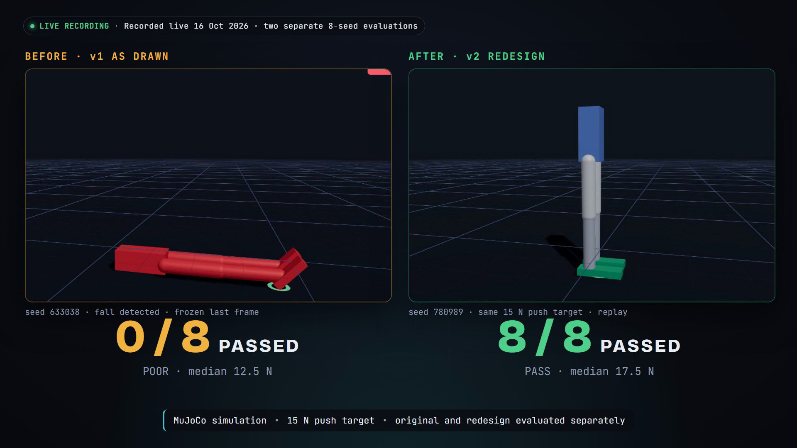
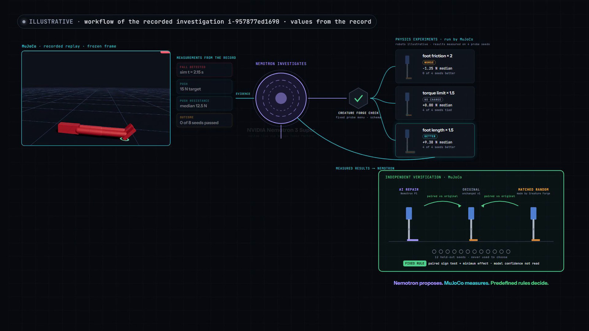
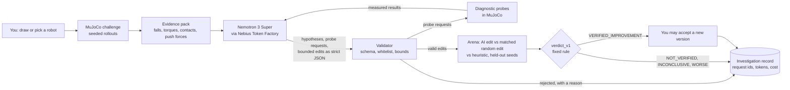
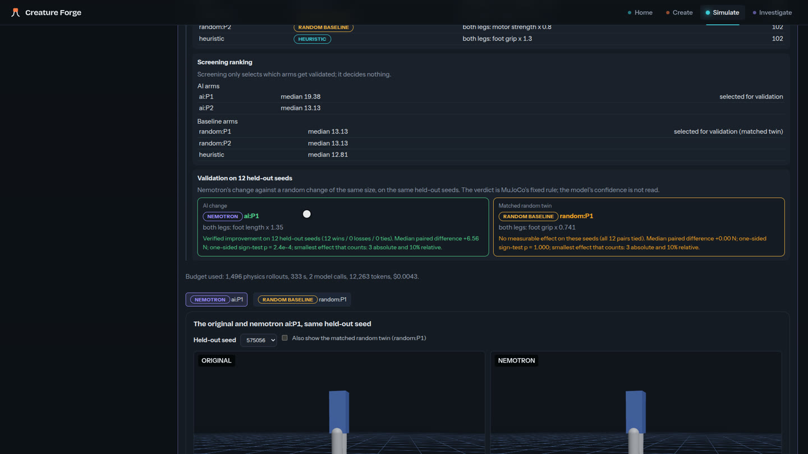

# Creature Forge

**An AI agent that investigates robot failures, requests controlled physics experiments, and proposes repairs that are independently verified in simulation.**

You draw a two-legged robot or load a damaged one, and MuJoCo measures how it fails. **NVIDIA Nemotron**, called at runtime
through **Nebius Token Factory**, is the reasoning component: it reads the measurements, forms hypotheses and can request
diagnostic experiments from a permitted menu. Creature Forge validates each request and runs it in MuJoCo, and the
measured results return to Nemotron, which uses them to propose bounded changes to the robot. Valid proposals are screened
in MuJoCo, and the selected one is tested on seeds the model never saw, next to a random change of the same size. A fixed
rule decides whether the improvement is real, and an engineer decides whether to accept a verified design. The model
proposes, the physics measures, the rule judges and the engineer accepts.

Built for the Nebius × NVIDIA Global AI Hackathon 2026, **Physical AI** track. Simulation only; no hardware.
[Demo video](https://youtu.be/hPY-_cK5Oow) · [Devpost](https://devpost.com/software/creature-forge)


<sub>Frame from the [demo video](https://youtu.be/hPY-_cK5Oow?t=13) at 0:13. Both panels are recorded MuJoCo replays from the live run,
on the same 15 N push target but from two separate 8-seed evaluations with different seeds. v2 is the verified
foot-length change Nemotron proposed, accepted by the engineer.</sub>

## Why this is an AI-agent system
A simulator alone runs whatever it is told. A language model alone can comment on results, but nothing tests what it
says. Here the model takes part in the investigation: it decides what to test, requests permitted experiments, reads the
measurements and proposes a concrete change. Information flows both ways:

**Failure evidence → Nemotron hypotheses and experiment requests → validated MuJoCo experiments → measured feedback →
Nemotron redesign proposal → independent physics verification.**

The agent is bounded. Nemotron has no direct access to MuJoCo: Creature Forge validates its requests and replies, runs
the experiments and applies fixed acceptance rules. The model never judges its own result, and each investigation is a
limited run, not a continuous autonomous repair cycle, and only an engineer can accept a verified change.

## Why this problem
When a robot falls, trying another design is easy; knowing *why* it failed is hard. Language models produce plausible
physical explanations, and plausible is not the same as true. In our first live trial the model blamed torso inertia and
proposed a lighter torso; MuJoCo showed the robot still fell on every seed. Creature Forge treats every model output as a
claim to be tested:
- explanations must cite measured evidence, and the code checks that each citation resolves;
- every proposed change is checked against a whitelist and physical bounds, and is rejected, never clipped;
- every surviving change is simulated on held-out seeds against a matched random baseline;
- negative and inconclusive results are recorded and shown, not dropped.

The same need arises wherever simulation is used to debug physical systems before hardware: legged robots, mechanisms and
controllers. The goal is an AI collaborator whose suggestions come with physical evidence that they work, or that they
do not.

## What you can do in the Studio
| Module | What happens | AI involvement | Needs |
|---|---|---|---|
| **Forge Loop**: *Create → Draw*, then *My creature* | Draw a biped. Run a stand, push or walk challenge in MuJoCo. *Investigate with AI*: Nemotron reads an evidence pack, may request up to 3 diagnostic probes and proposes edits; the arena validates them against a matched random edit; you can accept only a VERIFIED version | **Live** Nemotron 3 Super with a key; a labelled SCRIPTED MOCK without one | Local CPU; a Token Factory key for live calls |
| **Nemotron's experiment** (`?tab=nemotron`) | Playback of a recorded live run of the Hypothesis-as-Simulation (HaS) scientist on a robot with a hidden weak side. Nemotron and the deterministic engine choose different experiments from the same evidence; the repair is then verified | Recorded real calls, request ids shown | Nothing |
| **Verified repair** (`?tab=recovery`) | Playback of a robot on a slippery floor: two optimiser repairs side by side, judged by the pre-declared full-recovery verifier | **None** (NO_AI): a change to the optimiser's objective | Nothing |
| *Simulate → Playground / Compare* | Live MuJoCo rollouts, parameter sliders and matched-seed comparisons | None | Local CPU |
| *Investigate → AI investigation, AI scientist, Causal engineer, Experiment history* | Recorded investigations with their evidence, verdicts and replays | Recorded | Nothing |

## How it works
[](https://youtu.be/hPY-_cK5Oow?t=15)
<sub>Illustrative still; values come from the recorded investigation. [Watch the 25-second animated walkthrough](https://youtu.be/hPY-_cK5Oow?t=15).</sub>


1. **Measure.** MuJoCo 3.15 runs the challenge on fixed, role-separated seeds and records falls, posture, contacts,
   torques and critical push forces.
2. **Ask.** `creature_forge/forge_ai.py` builds a compact evidence pack with citable paths and calls Nemotron 3 Super
   (`nvidia/nemotron-3-super-120b-a12b`, thinking off, strict `json_schema` output) through `creature_forge/nebius.py`.
3. **Check.** A reply that fails the schema, cites evidence that does not exist, or proposes an out-of-bounds edit is
   rejected with a named reason. Nothing is repaired or clipped.
4. **Experiment.** The model may request up to three whitelisted counterfactual probes, each with a stated expectation.
   MuJoCo runs them on separate seeds, and the results go back to the model as citable evidence.
5. **Verify.** The arena screens the AI's proposals, then validates the best one on held-out seeds beside a random edit
   of the same size. `verdict_v1` (`creature_forge/verdict.py`) decides; model confidence is never an input.
6. **Evolve.** Only a VERIFIED arm can be accepted. It becomes a new version with its lineage.

Every live call passes request, token and dollar caps and is written to an inference ledger with its request id. The key
is never logged. Component-level detail: [`docs/ARCHITECTURE.md`](docs/ARCHITECTURE.md) and
[`docs/FORGE_LOOP.md`](docs/FORGE_LOOP.md).

## NVIDIA and Nebius: what was actually used
| Technology | Role in this project | Where |
|---|---|---|
| **NVIDIA Nemotron 3 Super** (`nvidia/nemotron-3-super-120b-a12b`) | The runtime model of the Forge Loop investigator (hypotheses, probe requests, bounded edits) and of the HaS scientist (experiment choice, executable hypotheses, delegation). About 5,600 requests appear in our local ledger copies up to 2026-10-20, most from batch studies | `creature_forge/forge_ai.py`, `creature_forge/has_agent.py`, `experiments/forge_loop/model_config.json` |
| NVIDIA Nemotron 3 Ultra and Nano | Ultra: model calibration and the optional "deep" profile. Nano: the first investigator and connectivity tests | `experiments/forge_loop/calibration/REPORT.md`, `creature_forge/demo.py` |
| **Nebius Token Factory** | Every model call, through the OpenAI-compatible API with strict JSON-schema guided decoding | `creature_forge/nebius.py` |
| **Nebius AI Cloud** (Compute CPU VMs) | Batch MuJoCo studies (scoreboard, HaS studies, DS-1, W3/W4, E-1 and later research) on 8- and 64-vCPU VMs, driven by our own start, stop and sync tooling with a spend cap and service-account API stops | `infra/nebius/` |
| MuJoCo and our verifiers | Every measurement, verdict and replay | `creature_forge/challenges.py`, `arena.py`, `verdict.py`, `recovery.py` |

We did not use Nebius Serverless Jobs, Serverless Endpoints or DevPods; the cloud compute was Compute VMs. The project's
runtime use of Nebius is the live Token Factory call from the Studio. Nemotron is used as a hosted service; no weights are
distributed or fine-tuned.

## What was demonstrated, and how strongly
Each row names its evidence. NO_AI marks results that involve no language model.

### AI-guided investigation and redesign
| Result | Strength and caveats | Evidence |
|---|---|---|
| **Forge Loop scoreboard (pre-registered):** Nemotron's redesign verified in 6 of 12 investigations vs 1 of 12 for size-matched random edits (exact one-sided McNemar p = 0.031) | Small: six starter creatures, two replicates (6 push and 6 stand investigations); 5 of the 6 AI verifications were on push. The pilot had no walking investigations, and no Forge Loop walking redesign has verified | [`experiments/forge_loop/scoreboard/REPORT.md`](experiments/forge_loop/scoreboard/REPORT.md) |
| **Live end-to-end run:** a drawn creature fell short of a 15 N push target (0/8 seeds); Nemotron proposed "foot length × 1.35", verified 12 wins / 0 losses on held-out seeds while its matched random twin was inconclusive; the accepted v2 passed 8/8 on a separate re-challenge seed panel | Single recorded runs; every live attempt is listed, and the two walking attempts did not verify | [`experiments/forge_loop/demo_capture/README.md`](experiments/forge_loop/demo_capture/README.md), [`docs/submission/evidence/live_acceptance_2026-10-24.json`](docs/submission/evidence/live_acceptance_2026-10-24.json) |
| **Nemotron's experiment choice:** on identical evidence, its experiment moved the belief to the correct hidden fault where the engine's choice did not; its lane then fully recovered (23/24), the engine's partly (20/24) | One instance, selected afterwards. Across 36 paired instances Nemotron and the engine alone were level, 15 vs 14 (p = 0.50) | [`docs/NEMOTRON_CONTRIBUTION.md`](docs/NEMOTRON_CONTRIBUTION.md), `experiments/w2/` |

These results do not show that Nemotron beats deterministic methods. It was level with the engine in the row above, and
as a walking-recovery director it did worse than a fixed rule (below).


<sub>Studio, *My creature → Investigate with AI*, captured during a LIVE run on 2026-10-16 (2 Nemotron 3 Super calls,
$0.0043). Record: [`experiments/forge_loop/demo_capture/`](experiments/forge_loop/demo_capture/README.md).</sub>

### Supporting deterministic physics research
These results come from fixed procedures, not from Nemotron. The strongest effects in the programme are deterministic.

| Result | Strength and caveats | Evidence |
|---|---|---|
| **Walking recovery (pre-registered confirmatory, NO_AI winner):** a fixed engineering procedure (a foot-placement controller, body–controller co-design and verdict-aware selection) fully recovered 19 of 48 fresh robots that could not walk. The Nemotron director recovered 9 of 48 at equal compute; "AI beats the rule" was not supported (p = 0.996) | A strong classical result and a clear negative for the AI director on walking | [`docs/WALK_RECOVERY.md`](docs/WALK_RECOVERY.md), `experiments/walk_recovery/confirmatory/` |
| **Verified repair (NO_AI):** an objective change (DO-1) turned the optimiser's partial repair (19/24) into a full recovery (21/24 and the 20 s endurance run); a pre-registered replication gave 5/5 vs 0/5 (p = 0.031) | One robot, its studied seeds, thin margins. A later 18-robot development study (R0) found DO-1 is **not** a general improvement | [`docs/DO1_REPLICATION_REPORT.md`](docs/DO1_REPLICATION_REPORT.md), [`docs/RESEARCH_STATUS.md`](docs/RESEARCH_STATUS.md) |
| **Registered held-out study E-1 (NO_AI):** on 160 robots with unseen damage, the physics-diagnosis engine recovered 56 vs 46 for exhaustive search (p = 0.061, **inconclusive**). Switching diagnosis off gave 42 (p = 0.017), which meets the registered secondary criterion only (0.050 corrected over all three tests) | Supportive, not study-wide confirmatory | [`docs/E1_RESULTS.md`](docs/E1_RESULTS.md) |

**Not demonstrated: learning from experience.** Every direct test of memory or experience-based improvement (Forge Loop
lessons, RL-1, EM-1, DI-1, VEL-1, VEL-2, H1, H3) was null, failed its gate or was not evaluable. The list with each
registered decision is in [`docs/RESEARCH_STATUS.md`](docs/RESEARCH_STATUS.md).

## Quick start (no API key, no cloud, about 10 minutes)
Prerequisites: Python 3.11 or 3.12, Node 22+ and Git. Chrome or Edge is needed only for the browser checks. An ordinary
laptop is enough: the demo pages are playback, and live challenges run MuJoCo on the local CPU.

```sh
git clone https://github.com/mahdinass/Creature-Forge.git && cd Creature-Forge
python -m venv .venv
.venv/bin/pip install -e ".[studio]"            # Windows: .venv\Scripts\pip install -e ".[studio]"
npm --prefix studio ci && npm --prefix studio run build
.venv/bin/python scripts/run_studio.py          # Windows: .venv\Scripts\python scripts\run_studio.py
```
Open <http://127.0.0.1:8000>. On Windows, `powershell -ExecutionPolicy Bypass -File scripts\start_studio.ps1` does all of
the start-up and opens the browser.

**Three things to try:**
1. <http://127.0.0.1:8000/?tab=nemotron>: Nemotron's recorded experiment. These are real model calls played back, with
   their request ids; no key is needed.
2. The Forge Loop: *Create → Draw*, *Use this creature*, run the push challenge, then investigate. MuJoCo, the arena and
   the verdict are always real. Without a key the AI step is a clearly labelled SCRIPTED MOCK (*Run scripted mock*); with
   your own Token Factory key, *Investigate with AI* calls Nemotron live (see below).
3. <http://127.0.0.1:8000/?tab=recovery>: the verified repair (NO_AI), three robots replayed side by side. It is a
   supporting demonstration of independent physics verification.

Step-by-step judge guide with expected results and troubleshooting:
[`docs/submission/JUDGE_TESTING.md`](docs/submission/JUDGE_TESTING.md).

## Live Nemotron (optional; your own Token Factory key; fractions of a cent per call)
```sh
cp .env.example .env    # then set NEBIUS_API_KEY=<key> and CREATURE_FORGE_ENABLE_LIVE=1
```
Restart the Studio. *My creature → Investigate with AI* then calls Nemotron 3 Super live: at most 4 calls per
investigation, about $0.002 to $0.004 each in our records. The key is read from the environment or the git-ignored `.env`
and is never logged. Full reference: [`docs/submission/SETUP_AND_REPRODUCTION.md`](docs/submission/SETUP_AND_REPRODUCTION.md).

## Tests and reproduction
```sh
.venv/bin/python -m unittest discover -s tests      # about 1,600 tests; some skip without git-ignored raw records
npm --prefix studio test && npm --prefix studio run build
.venv/bin/python scripts/smoke_test.py              # MuJoCo rollout, determinism, fall detection
.venv/bin/python scripts/lab_browser_check.py       # real-browser flows, including both demo pages (Chrome or Edge)
```
Statistics can be recomputed from committed raw records without physics, for example
`python scripts/do1_replication_analysis.py --w3 experiments/do1/w3w4_2026-10-21/do1_l4_rep.jsonl --w4 experiments/do1/w3w4_2026-10-21/do1_x.jsonl`.
The recorded experiments ran on Linux (Python 3.12.3, NumPy 2.5.4, MuJoCo 3.15.0). Windows reproduces labels and verdicts
but not every float bit for bit. CI (GitHub Actions, Ubuntu) runs all four checks on a clean checkout.

## Limitations
- **Simulation only:** one planar biped family in MuJoCo. Nothing has been tested on hardware.
- **Nemotron's measured advantage is narrow:** one pre-registered win over random edits, mostly on push challenges, and
  parity with the deterministic engine in the larger scientist study. Forge Loop walking redesigns never verified, and on
  walking recovery the AI director did worse than a fixed rule.
- **No experience learning** has been demonstrated (see above).
- **Recorded pages are playback** of hash-pinned records; the Studio does not start the batch studies. Large raw archives
  and video files are outside Git ([`docs/NONGIT_ASSETS_2026-10-21.md`](docs/NONGIT_ASSETS_2026-10-21.md)).

## Repository map
| Path | Contents |
|---|---|
| `creature_forge/` | Python package: physics (`simulate`, `challenges`, `walking`), investigation (`forge_ai`, `probes`, `arena`, `verdict`), scientist (`belief_engine`, `has_agent`), optimiser (`walk_opt`), Nebius client and ledger, Studio API (`studio/`) |
| `studio/` | React + three.js frontend; `studio/e2e/` real-browser flows and capture scripts |
| `experiments/` | Pre-registered protocols, raw records and reports; `FROZEN_MANIFEST.json` pins every frozen record |
| `scripts/` | Studio launchers, study runners, analyses and exporters |
| `tests/` | Python test suite, including provenance guards |
| `infra/nebius/` | Nebius VM control: spend cap, deadline watchdog, service-account API stop |
| `docs/` | Architecture, research reports and the submission package; index in [`docs/README.md`](docs/README.md) |

## License and terms
Apache License 2.0 ([`LICENSE`](LICENSE), [`NOTICE`](NOTICE)); third-party inventory in
[`THIRD_PARTY_NOTICES.md`](THIRD_PARTY_NOTICES.md). NVIDIA Nemotron is used only as a hosted model under its own terms
([`docs/MODEL_AND_SERVICE_TERMS.md`](docs/MODEL_AND_SERVICE_TERMS.md)). This is an independent hackathon project, not
endorsed by NVIDIA or Nebius. Commits written with an AI coding assistant carry a `Co-Authored-By` disclosure.

Contributors and coding agents: start with [`AGENTS.md`](AGENTS.md) and `docs/PROJECT_STATE.md`.
