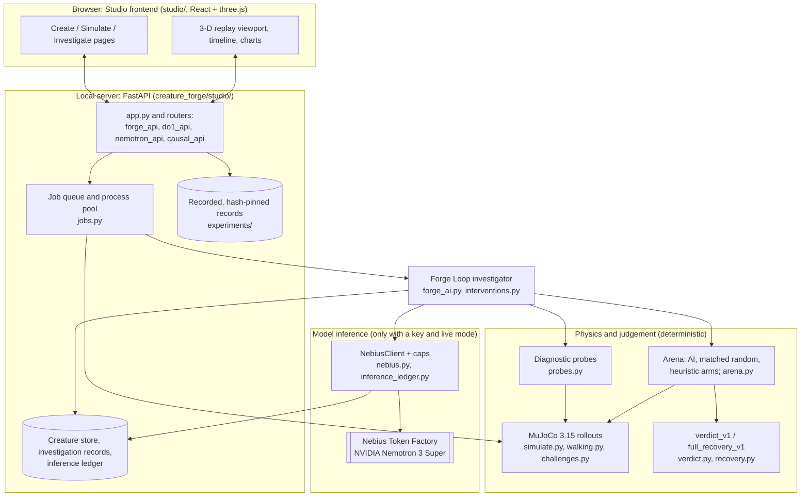
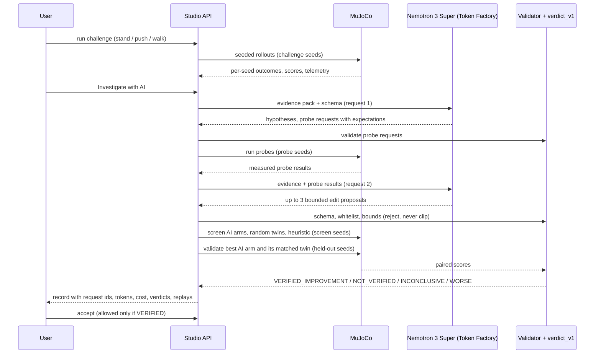
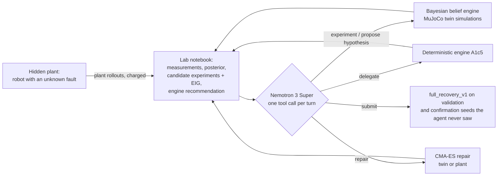

# Architecture

This page describes the components that exist in the code and how they interact. Planned or proposed components are
not shown. File names are relative to the repository root.

## 1. System overview

Two kinds of page share this server:
- **Interactive pages** (Draw, Playground, Compare, My creature) run MuJoCo on the local machine through the job queue.
  Three interactive paths can call a language model, and only when `NEBIUS_API_KEY` and `CREATURE_FORGE_ENABLE_LIVE=1`
  are set: *My creature → Investigate with AI* (the Forge Loop investigation, the main one), *My creature → Recover
  walking* (AI director) and *AI investigation → Run live* (the original Nano path, `creature_forge/demo.py`). Without a
  key each runs a labelled SCRIPTED MOCK proposer.
- **Recorded pages** (Nemotron's experiment, Verified repair, AI scientist, Causal engineer, AI investigation, history)
  serve committed records. The Verified repair and Nemotron routers check SHA-256 sums before serving anything. No
  simulation or model call happens on these pages.

## 2. The Forge Loop investigation (live module)

- The diagram shows an investigation with probes on (two model requests). With probes off, one request returns the
  hypotheses and proposals directly.
- **Seeds** come from hashed blocks with disjoint roles (challenge, train, screen, validate, probe).
- **Matched random twin:** for the AI arm that is validated, a random edit of the same size on the same parameters is
  validated on the same seeds. A VERIFIED AI arm beside a VERIFIED twin is shown as such.
- **Caps:** at most 4 model calls and 80,000 tokens per investigation, plus global request and dollar caps. A call whose
  worst-case cost would exceed a cap is refused before it is sent.
- Contracts and thresholds: [`FORGE_LOOP.md`](FORGE_LOOP.md), [`FORGE_LOOP_CONTRACTS.md`](FORGE_LOOP_CONTRACTS.md).

## 3. The HaS scientist on the Hidden-Damage Bench (batch studies; recorded in the Studio)

- Code: `creature_forge/has_agent.py`, `belief_engine.py`, `hdb_bench.py`, `walk_opt.py`; runner
  `scripts/hdb_agent_run.py`, run on Nebius VMs. The Studio only plays back its records.
- An invalid model reply falls back to the engine's recommendation, and the fallback is recorded. An agent that always
  delegates reproduces the engine-only arm exactly, which is how Nemotron's own decisions are attributed.
- **`full_recovery_v1`** (`creature_forge/recovery.py`): the candidate must beat the original under `verdict_v1` on 24
  validation seeds, walk on at least 80 % of them, and then walk the full 20 s on at least 80 % of disjoint confirmation
  seeds. Errors are never counted as successes.

## 4. Verified repair (DO-1, NO_AI)
The *Verified repair* page compares two CMA-ES optimiser repairs of one robot on a slippery floor: the frozen objective
and the DO-1 objective (a deterministic change to what the optimiser rewards). Both are judged by `full_recovery_v1`. The
page plays back exports that were reproduced row by row from the experimental records on Linux before export
(`scripts/do1_demo_export.py`, `experiments/do1/demo/`). No language model is involved.

## 5. Inference safety and provenance
| Mechanism | Where |
|---|---|
| Request, token, per-investigation and dollar caps; no blind retries; key never logged or put in `repr` | `creature_forge/nebius.py` |
| Persistent inference ledger: request id, model, tokens, cost, purpose | `creature_forge/inference_ledger.py` |
| Strict JSON schema with enumerated hypothesis ids, editable parameters and citable evidence paths | `creature_forge/forge_ai.py` |
| Reject-never-clip edit validation | `creature_forge/interventions.py` |
| Every record carries the code commit and a dirty flag | investigation records |
| Frozen experiment records pinned by git blob id | `experiments/FROZEN_MANIFEST.json`, `tests/test_frozen_records.py` |
| Recorded demo files pinned by SHA-256 before serving | `creature_forge/studio/do1_api.py`, `nemotron_api.py` |

## 6. Where things run
| Work | Where |
|---|---|
| Studio, interactive MuJoCo, recorded pages | The user's machine (any OS) |
| Live model calls | Nebius Token Factory, called from the user's machine |
| Batch studies (scoreboard, HaS, DS-1, W3/W4, E-1, R0, H1, H3 and others) | Nebius AI Cloud Compute VMs (8 and 64 vCPU, Linux), controlled by `infra/nebius/forge_cloud.py` and `forge_dev.py` |
| Demo exports | Main Nebius VM, fail-closed against the recorded rows |

Nothing in the system trains or fine-tunes a model. "Memory" components in the research code (`has_memory.py`,
`repair_memory.py` on research branches) are deterministic retrieval or small statistical models, and none of them has
shown a benefit (see [`RESEARCH_STATUS.md`](RESEARCH_STATUS.md)).
